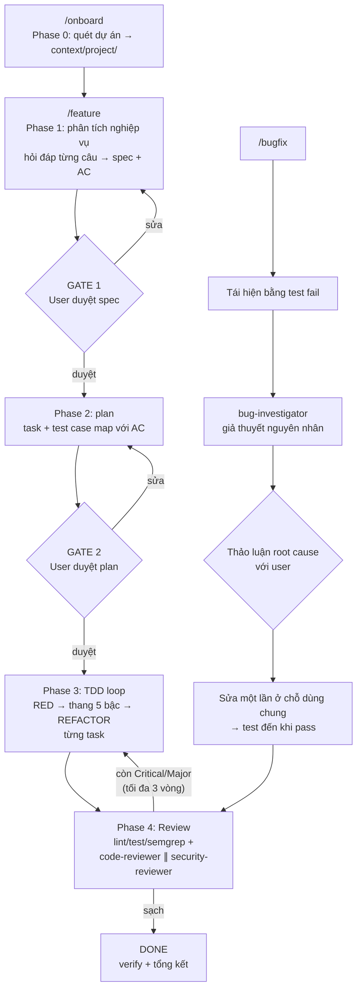

# AI Dev Workflow

Workflow phát triển phần mềm với AI cho developer team: **requirement → spec → plan → TDD → review**, cùng một flow riêng để **debug bug**. Khi viết code, agent dừng ở cách ngắn nhất vẫn làm đủ yêu cầu đã duyệt: dùng lại code sẵn, nền tảng, rồi dependency đang cài, trước khi viết mới. Cài vào dự án bằng `npx`, dùng được với **Cursor** hoặc **Claude Code**.

*A structured AI software development workflow for teams. [English below](#english).*

---

## Tiếng Việt

### Flow tổng quan



Sau Gate 2, agent **tự chạy liên tục** qua TDD → review → fix → review cho đến khi sạch. Agent chỉ dừng lại hỏi khi chạm giới hạn vòng lặp: 5 lần thử mỗi task TDD, 3 vòng review, 3 lần fix bug thất bại.

Lúc plan và lúc GREEN, agent dừng ở bậc đầu tiên còn làm đủ acceptance criteria: code đã có trong repo, thư viện chuẩn hoặc tính năng nền tảng, dependency đang cài, một dòng đọc là hiểu, rồi mới đến code tối thiểu. Spec đã duyệt và `conventions.md` thắng bậc ngắn hơn. Không cắt validation ở biên tin cậy, xử lý lỗi để khỏi mất dữ liệu, bảo mật, hay accessibility. Review ghi **Major** nếu dựng lại thứ repo đã có, thêm dependency chỉ vì vài dòng, hoặc tạo pattern mới trái convention.

### Skill dùng cho từng bước

| Bước | Skill trong repo | Dựa trên best practice |
|---|---|---|
| 0. Onboarding | `project-onboarding` | spec-kit `/constitution` |
| 1. Phân tích nghiệp vụ | `requirement-analysis` | superpowers `brainstorming` + spec-kit `/specify`, `/clarify` |
| 2. Lên plan, test case | `implementation-planning` | superpowers `writing-plans` + spec-kit `/plan`, `/tasks`, `/analyze` + thang gọn của [ponytail](https://github.com/dietrichgebert/ponytail) |
| 2. TDD | `tdd-loop` | superpowers `test-driven-development` + `subagent-driven-development` + thang 5 bậc của ponytail, sau test đỏ |
| 3. Review code | `code-review` | superpowers `requesting/receiving-code-review` + Google eng-practices + mục Necessary code |
| 3. Security | `security-review` | Anthropic `claude-code-security-review` + OWASP Top 10 / ASVS |
| 4. Bug | `systematic-debugging` | superpowers `systematic-debugging` + `root-cause-tracing`; sửa một lần ở chỗ dùng chung |
| Mọi bước | `verification-before-completion` | superpowers `verification-before-completion` |
| Điều phối | `ai-dev-workflow` | state machine, gate, giới hạn vòng lặp |

Chi tiết nguồn tham khảo xem trong [CREDITS.md](CREDITS.md).

### Ai làm việc gì

Phiên chat đang nói với bạn là điều phối. Skill `ai-dev-workflow` chọn bước tiếp theo, hỏi bạn ở các cổng, và ghi `status.json`. Subagent nhận một brief hẹp, làm xong thì trả kết quả. Không spawn được thì phiên chính làm đúng checklist đó và ghi `mode: inline`.

Một feature hoặc một bug trong `ACTIVE.json`. Task code chạy lần lượt: một `tdd-implementer`, kiểm tra xong, rồi task sau. Dấu `[P]` trong plan cũ bị bỏ qua. Hai reviewer được chạy cùng lúc vì cùng chỉ đọc. Người viết code và người review không dùng chung một chat.

| Việc | Phiên chính giữ | Subagent | Brief được đưa |
|---|---|---|---|
| `/onboard` | Hỏi bạn xác nhận, rồi viết `context/project/` | `codebase-analyst`, chỉ đọc | Quét manifest, cây thư mục, convention, lệnh, và 3–5 màn hình UI mẫu. Không gọi Figma |
| Spec | Hỏi đáp và viết `02-spec.md` | không có | |
| Plan | Viết `03-plan.md` và `04-test-cases.md`, cắt task `T-xx` | `codebase-analyst` khi cần tìm feature giống để dùng lại | Đường dẫn pattern tìm được. Plan vẫn do phiên chính viết |
| Mỗi task code | Chờ một dòng evidence, rồi mới giao task sau. Hết task mới chạy suite, lint, typecheck, build một lần | `tdd-implementer`, một task | Khối `T-xx`, các dòng TC của task đó, `structure.md`, một lệnh chạy đúng file test. Có UI thì thêm `ui-source.md` và dòng nguồn của task |
| Docs / infra / config | Tự làm từng task và chạy check `CK-xx` | không giao `tdd-implementer` | Không có vòng test đỏ |
| Review vòng 1 | Chạy semgrep, gitleaks, audit nếu máy có. Giữ tối đa 40 dòng trỏ vào file trong diff. Ghi `06-review.md` | `code-reviewer` và `security-reviewer` song song, chỉ đọc | Reviewer code: diff đúng phạm vi, AC, TC khớp, `structure.md`, `conventions.md`, `ui-source.md` nếu task có UI. Reviewer security: cùng diff, mục security của `tech-stack.md`, đoạn scanner |
| Review vòng sau | Triage finding, đưa finding test được về `tdd-implementer` từng cái | cùng hai reviewer | Chỉ diff của bản sửa và id finding còn mở |
| `/bugfix` tái hiện | Hỏi bạn, viết test fail, ghi `01-report.md` | không có | |
| Điều tra bug | Đưa giả thuyết cho bạn, chờ đồng ý nguyên nhân | `bug-investigator`, chỉ đọc, không viết bản sửa | `01-report.md`, một dòng test fail, `structure.md` |
| Sửa bug | Đếm lần thử, chạy suite một lần sau lần sửa cuối | `tdd-implementer` | Test tái hiện là TC đang đỏ |
| PR và Done | `deliver-pr` rồi `verification-before-completion` | không có | |

Brief của `tdd-implementer` không kèm `01-discussion.md`, phần còn lại của spec, task khác, phần còn lại của `context/project/`, hay log test các task trước. Reviewer không thấy lý do của người vừa code, và không chạy lại scanner. Reviewer mà sửa được file, hoặc ngồi cùng chat với người code, thì vòng đó ghi `isolation: degraded` và không review thêm một lượt trong cùng vòng.

### Cài đặt vào dự án

Đứng trong thư mục gốc của dự án:

npm 12 chặn cài từ Git nếu thiếu `--allow-git=all`. Nên **pin commit** (không lấy tip `main` trần):

```bash
# Claude Code
npx --allow-git=all github:nguyendangtruong79/ai-dev-workflow#<commit-sha> claude

# Cursor
npx --allow-git=all github:nguyendangtruong79/ai-dev-workflow#<commit-sha> cursor

# nâng cấp pack: backup rồi ghi đè .cursor/.claude (không đè context/project)
npx --allow-git=all github:nguyendangtruong79/ai-dev-workflow#<commit-sha> claude --force

# xem trước, không ghi
npx --allow-git=all github:nguyendangtruong79/ai-dev-workflow#<commit-sha> claude --dry-run
```

Installer ghi `context/workflow-version.json` (version pack, tool, thời điểm cài). `--force` sao lưu file sẽ bị ghi đè vào `.ai-dev-workflow-backup-<timestamp>/` trước khi copy.

Sau khi package được publish lên npm:

```bash
npx @nguyendangtruong79/ai-dev-workflow@0.3.0 claude
```

Clone repo rồi cài vẫn được:

```bash
git clone https://github.com/nguyendangtruong79/ai-dev-workflow
./ai-dev-workflow/install.sh claude /đường/dẫn/dự-án
```

### Sử dụng

| Lệnh | Việc làm |
|---|---|
| `/onboard` | Chạy 1 lần: quét stack, cấu trúc folder, convention, lệnh test/lint, và nguồn UI → `context/project/` |
| `/feature <yêu cầu>` | Chạy toàn bộ flow cho một feature |
| `/plan [feature-id]` | Chỉ chạy bước lên plan |
| `/implement [feature-id]` | Chỉ chạy TDD loop |
| `/review [feature-id]` | Review code + security cho diff hiện tại |
| `/deliver [id]` | Tạo/cập nhật PR, ghi evidence CI, rồi DONE |
| `/bugfix <mô tả bug>` | Flow debug: tái hiện → điều tra → thảo luận → fix → review → deliver |
| `/status [continue]` | Xem trạng thái hoặc tiếp tục công việc đang dở |

Hãy commit `.cursor/` hoặc `.claude/` cùng với `context/` để cả team dùng chung workflow và chung tài liệu.

### Folder `context/` trong dự án

```
context/
├── project/          tech-stack.md, structure.md (luật đặt file), conventions.md, commands.md, ui-source.md
├── features/<YYYYMMDD>-<slug>/
│   STATUS.md, 01-discussion.md, 02-spec.md, 03-plan.md,
│   04-test-cases.md, 05-implementation-log.md, 06-review.md
└── bugs/<YYYYMMDD>-<slug>/
    STATUS.md, 01-report.md, 02-investigation.md, 03-fix.md
```

Requirement được truy vết đến tận test: `AC-xx` (acceptance criteria trong spec) → `TC-xx` (test case) → task `T-xx` → file test. Vì vậy "pass hết test" đồng nghĩa với "đáp ứng đủ yêu cầu".

### Cấu trúc repo

```
cursor/
  .cursor/rules/ai-dev-workflow.mdc   luật luôn áp dụng
  .cursor/skills/<9 skills>/          SKILL.md + templates/
  .cursor/agents/                     codebase-analyst, tdd-implementer, code-reviewer,
                                      security-reviewer, bug-investigator
  .cursor/commands/                   onboard, feature, plan, implement, review, bugfix, status
  context/README.md
claude-code/
  .claude/rules/ai-dev-workflow.md    (Claude Code tự động load)
  .claude/skills/  .claude/agents/  .claude/commands/
  context/README.md
package.json  bin/cli.js   # lệnh npx / npm
install.sh
scripts/sync-skills.sh  scripts/check-sync.sh
```

### Đóng góp và tùy biến

- Skill được viết một lần trong `cursor/.cursor/skills/`. Sau khi sửa, chạy `scripts/sync-skills.sh` để copy sang `claude-code/`, rồi chạy `scripts/check-sync.sh` để kiểm tra (CI cũng chạy bước này).
- Agent và command có frontmatter riêng cho từng tool, nên khi sửa cần sửa cả hai bên.
- Muốn thêm luật riêng cho stack (ví dụ Next.js, Zustand, shadcn/ui, React Query), hãy ghi vào `context/project/conventions.md` và `tech-stack.md`. Reviewer đọc hai file đó. Không cần một skill cho từng thư viện. Nếu một skill thêm lệch với `conventions.md`, convention của dự án thắng.
- Thang gọn không được bỏ acceptance criterion, không được bỏ test đỏ, và không thay `/review`.
- Công cụ bảo mật tùy chọn, có thì reviewer tự dùng: [Semgrep](https://semgrep.dev), [Gitleaks](https://github.com/gitleaks/gitleaks), và lệnh audit dependency của stack (`npm audit`, `pip-audit`, `govulncheck`...).

---

## English

A team workflow for AI-assisted development with two human gates and autonomous loops in between:

1. **`/onboard`** (once) captures tech stack, structure/placement rules, conventions, commands, and the UI source (`figma`, `codebase`, or `none`) into `context/project/`.
2. **`/feature <requirement>`** runs a one-question-at-a-time business analysis dialogue and produces `02-spec.md` with Given/When/Then acceptance criteria. **Gate 1**: you approve the spec.
3. Planning produces ordered, test-first tasks and a test-case catalog traced to each AC. Each behavior stops at the first rung that still meets the spec: existing code, the platform, an installed dependency, then the minimum new code. **Gate 2**: you approve the plan.
4. **TDD loop**: red, then the same five-rung ladder, then refactor, one task at a time (max 5 attempts). The approved spec and `conventions.md` win over a smaller option. The full suite, lint, typecheck, and build run once at the end of BUILD.
5. **Review**: automated checks, then independent `code-reviewer` (spec compliance, file placement, conventions, stack best practices, test quality, necessary code) and `security-reviewer` (OWASP Top 10/ASVS, secrets, dependencies) subagents. A new dependency for a few lines, or a from-scratch replacement of something the repo already has, is a Major finding. Critical/Major findings loop back to TDD (max 3 rounds).
6. **`/bugfix`**: reproduce with a failing test → `bug-investigator` produces ranked root-cause hypotheses → agree on the root cause with you → one fix in the shared code → loop tests until green → review.

### Who does the work

The chat you talk to is the orchestrator (`ai-dev-workflow`). It owns the gates, `status.json`, and the order of work. A subagent gets one narrow brief and returns. If it cannot be spawned, the same checklist runs in the parent chat with `mode: inline`.

One active feature or bug. Code tasks run one `tdd-implementer` at a time; a `[P]` mark is ignored. The two reviewers may run together because both are read-only. The implementer and the reviewers do not share a chat.

| Work | Parent keeps | Subagent | Brief |
|---|---|---|---|
| `/onboard` | Confirms with you, then writes `context/project/` | `codebase-analyst` (read-only) | Manifests, tree, conventions, commands, 3–5 reference screens. No Figma calls |
| Spec | The dialogue and `02-spec.md` | none | |
| Plan | `03-plan.md`, `04-test-cases.md`, task split | `codebase-analyst` only to find a similar feature | Paths to reuse. The parent still writes the plan |
| Each code task | Waits for one evidence line, then the next task. Full suite, lint, typecheck, and build run once at the end | `tdd-implementer`, one task | That `T-xx` block, its TC rows, `structure.md`, the single-test command. Plus `ui-source.md` and the task's UI line when the task has a UI |
| Docs / infra / config | The parent runs each `CK-xx` | not `tdd-implementer` | No red/green loop |
| Review round 1 | Runs semgrep, gitleaks, and the dependency audit when installed (at most 40 lines that name a file in the diff). Writes `06-review.md` | `code-reviewer` and `security-reviewer`, in parallel, read-only | Code: scoped diff, ACs, matching TCs, `structure.md`, `conventions.md`, `ui-source.md` when a task has a UI. Security: the same diff, the security section of `tech-stack.md`, the scanner excerpt |
| Later review rounds | Triage. Each testable Critical/Major goes back to `tdd-implementer` as one mini-task | the same two reviewers | Fix diff and the open finding ids only |
| Bug report and reproduce | Questions, failing test, `01-report.md` | none | |
| Bug investigation | Presents hypotheses and waits for your agreement | `bug-investigator` (read-only, no fix) | `01-report.md`, the one-line failure, `structure.md` |
| Bug fix | Counts attempts, runs the suite once after the last edit | `tdd-implementer` | The reproduction test as the failing TC |
| PR and done | `deliver-pr`, then `verification-before-completion` | none | |

The implementer brief omits `01-discussion.md`, the rest of the spec, other tasks, the rest of `context/project/`, and earlier test logs. Reviewers do not see the implementer's reasoning and do not re-run scanners. A reviewer that can edit files, or that shares the implementer's chat, is recorded as `isolation: degraded` for that round, and that round is not repeated.

Install from the project root, then run `/onboard`:

```bash
npx --allow-git=all github:nguyendangtruong79/ai-dev-workflow#<commit-sha> claude
npx --allow-git=all github:nguyendangtruong79/ai-dev-workflow#<commit-sha> cursor
```

Pin a commit. `--force` backs up then overwrites pack files (never `context/project/*`). `--dry-run` previews. After npm publish: `npx @nguyendangtruong79/ai-dev-workflow@0.3.0 claude`.

Skills are original adaptations inspired by [obra/superpowers](https://github.com/obra/superpowers), [github/spec-kit](https://github.com/github/spec-kit), [anthropics/claude-code-security-review](https://github.com/anthropics/claude-code-security-review), [dietrichgebert/ponytail](https://github.com/dietrichgebert/ponytail) (smallest complete change only; gates, red tests, and `conventions.md` stay in charge), and OWASP. See [CREDITS.md](CREDITS.md). License: MIT.
