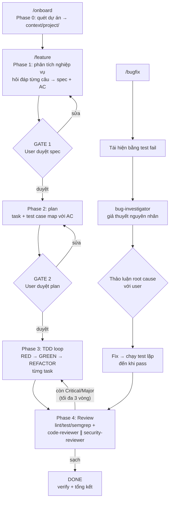

# AI Dev Workflow

Workflow phát triển phần mềm với AI cho developer team: **requirement → spec → plan → TDD → review**, cùng một flow riêng để **debug bug**. Cài vào dự án bằng `npx`, dùng được với **Cursor** hoặc **Claude Code**.

*A structured AI software development workflow for teams. [English below](#english).*

---

## Tiếng Việt

### Flow tổng quan



Sau Gate 2, agent **tự chạy liên tục** qua TDD → review → fix → review cho đến khi sạch. Agent chỉ dừng lại hỏi khi chạm giới hạn vòng lặp: 5 lần thử mỗi task TDD, 3 vòng review, 3 lần fix bug thất bại.

### Skill dùng cho từng bước

| Bước | Skill trong repo | Dựa trên best practice |
|---|---|---|
| 0. Onboarding | `project-onboarding` | spec-kit `/constitution` |
| 1. Phân tích nghiệp vụ | `requirement-analysis` | superpowers `brainstorming` + spec-kit `/specify`, `/clarify` |
| 2. Lên plan, test case | `implementation-planning` | superpowers `writing-plans` + spec-kit `/plan`, `/tasks`, `/analyze` |
| 2. TDD | `tdd-loop` | superpowers `test-driven-development` + `subagent-driven-development` |
| 3. Review code | `code-review` | superpowers `requesting/receiving-code-review` + Google eng-practices |
| 3. Security | `security-review` | Anthropic `claude-code-security-review` + OWASP Top 10 / ASVS |
| 4. Bug | `systematic-debugging` | superpowers `systematic-debugging` + `root-cause-tracing` |
| Mọi bước | `verification-before-completion` | superpowers `verification-before-completion` |
| Điều phối | `ai-dev-workflow` | state machine, gate, giới hạn vòng lặp |

Chi tiết nguồn tham khảo xem trong [CREDITS.md](CREDITS.md).

### Cài đặt vào dự án

Đứng trong thư mục gốc của dự án:

npm 12 chặn cài từ Git nếu thiếu `--allow-git=all`:

```bash
# Claude Code
npx --allow-git=all github:nguyendangtruong79/ai-dev-workflow claude

# Cursor
npx --allow-git=all github:nguyendangtruong79/ai-dev-workflow cursor

# ghi đè file đã có
npx --allow-git=all github:nguyendangtruong79/ai-dev-workflow claude --force
```

Sau khi package được publish lên npm, lệnh ngắn hơn:

```bash
npx @nguyendangtruong79/ai-dev-workflow claude
```

Cài cố định trong dự án (devDependency), rồi chạy lại khi workflow có bản mới:

```bash
npm install -D github:nguyendangtruong79/ai-dev-workflow --allow-git=all
npx ai-dev-workflow claude
```

Clone repo rồi cài vẫn được:

```bash
git clone https://github.com/nguyendangtruong79/ai-dev-workflow
./ai-dev-workflow/install.sh claude /đường/dẫn/dự-án
```

### Sử dụng

| Lệnh | Việc làm |
|---|---|
| `/onboard` | Chạy 1 lần: quét stack, cấu trúc folder, convention, lệnh test/lint → `context/project/` |
| `/feature <yêu cầu>` | Chạy toàn bộ flow cho một feature |
| `/plan [feature-id]` | Chỉ chạy bước lên plan |
| `/implement [feature-id]` | Chỉ chạy TDD loop |
| `/review [feature-id]` | Review code + security cho diff hiện tại |
| `/bugfix <mô tả bug>` | Flow debug: tái hiện → điều tra → thảo luận → fix → lặp test |
| `/status [continue]` | Xem trạng thái hoặc tiếp tục công việc đang dở |

Hãy commit `.cursor/` hoặc `.claude/` cùng với `context/` để cả team dùng chung workflow và chung tài liệu.

### Folder `context/` trong dự án

```
context/
├── project/          tech-stack.md, structure.md (luật đặt file), conventions.md, commands.md
├── features/<YYYYMMDD>-<slug>/
│   STATUS.md, 01-discussion.md, 02-spec.md, 03-plan.md,
│   04-test-cases.md, 05-implementation-log.md, 06-review.md
└── bugs/<YYYYMMDD>-<slug>/
    STATUS.md, 01-report.md, 02-investigation.md, 03-fix.md
```

Requirement được truy vết đến tận test: `AC-xx` (acceptance criteria trong spec) → `TC-xx` (test case) → task `T-xx` → file test. Vì vậy "pass hết test" đồng nghĩa với "đáp ứng đủ yêu cầu".

### Cấu trúc repo

```
cursor/
  .cursor/rules/ai-dev-workflow.mdc   luật luôn áp dụng
  .cursor/skills/<9 skills>/          SKILL.md + templates/
  .cursor/agents/                     codebase-analyst, tdd-implementer, code-reviewer,
                                      security-reviewer, bug-investigator
  .cursor/commands/                   onboard, feature, plan, implement, review, bugfix, status
  context/README.md
claude-code/
  .claude/rules/ai-dev-workflow.md    (Claude Code tự động load)
  .claude/skills/  .claude/agents/  .claude/commands/
  context/README.md
package.json  bin/cli.js   # lệnh npx / npm
install.sh
scripts/sync-skills.sh  scripts/check-sync.sh
```

### Đóng góp và tùy biến

- Skill được viết một lần trong `cursor/.cursor/skills/`. Sau khi sửa, chạy `scripts/sync-skills.sh` để copy sang `claude-code/`, rồi chạy `scripts/check-sync.sh` để kiểm tra (CI cũng chạy bước này).
- Agent và command có frontmatter riêng cho từng tool, nên khi sửa cần sửa cả hai bên.
- Muốn thêm luật riêng cho stack (ví dụ Spring, React), hãy ghi vào `context/project/tech-stack.md` → mục *Stack-specific best practices*. Reviewer sẽ kiểm tra theo mục này.
- Công cụ bảo mật tùy chọn, có thì reviewer tự dùng: [Semgrep](https://semgrep.dev), [Gitleaks](https://github.com/gitleaks/gitleaks), và lệnh audit dependency của stack (`npm audit`, `pip-audit`, `govulncheck`...).

---

## English

A team workflow for AI-assisted development with two human gates and autonomous loops in between:

1. **`/onboard`** (once) captures tech stack, structure/placement rules, conventions, and commands into `context/project/`.
2. **`/feature <requirement>`** runs a one-question-at-a-time business analysis dialogue and produces `02-spec.md` with Given/When/Then acceptance criteria. **Gate 1**: you approve the spec.
3. Planning produces ordered, test-first tasks and a test-case catalog traced to each AC. **Gate 2**: you approve the plan.
4. **TDD loop**: red → green → refactor per task (max 5 attempts per task), with full-suite checks after each task.
5. **Review**: automated checks, then independent `code-reviewer` (spec compliance, file placement, conventions, stack best practices, test quality) and `security-reviewer` (OWASP Top 10/ASVS, secrets, dependencies) subagents. Critical/Major findings loop back to TDD (max 3 rounds).
6. **`/bugfix`**: reproduce with a failing test → `bug-investigator` produces ranked root-cause hypotheses → agree on the root cause with you → fix → loop tests until green → review.

Install from the project root, then run `/onboard`:

```bash
npx --allow-git=all github:nguyendangtruong79/ai-dev-workflow claude
npx --allow-git=all github:nguyendangtruong79/ai-dev-workflow cursor
```

After the package is published: `npx @nguyendangtruong79/ai-dev-workflow claude`. Add `--force` to overwrite existing files.

Skills are original adaptations inspired by [obra/superpowers](https://github.com/obra/superpowers), [github/spec-kit](https://github.com/github/spec-kit), [anthropics/claude-code-security-review](https://github.com/anthropics/claude-code-security-review), and OWASP. See [CREDITS.md](CREDITS.md). License: MIT.
